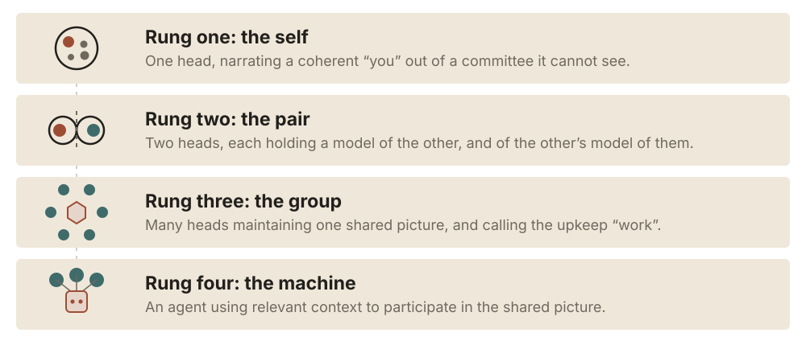
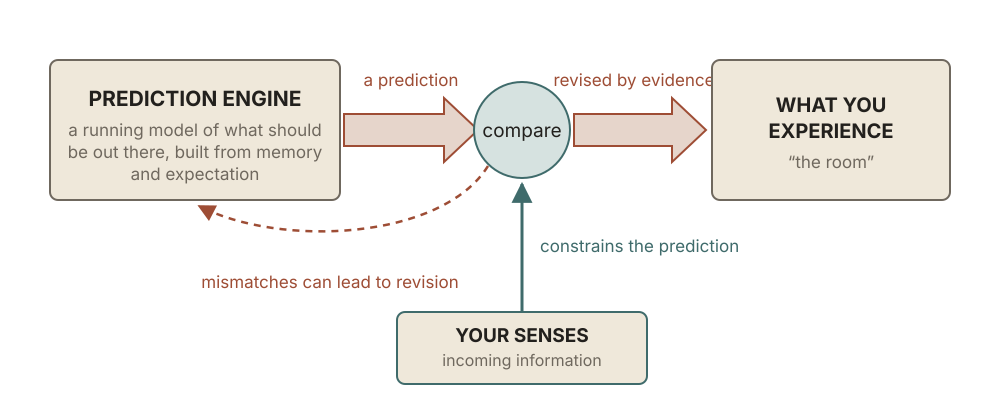
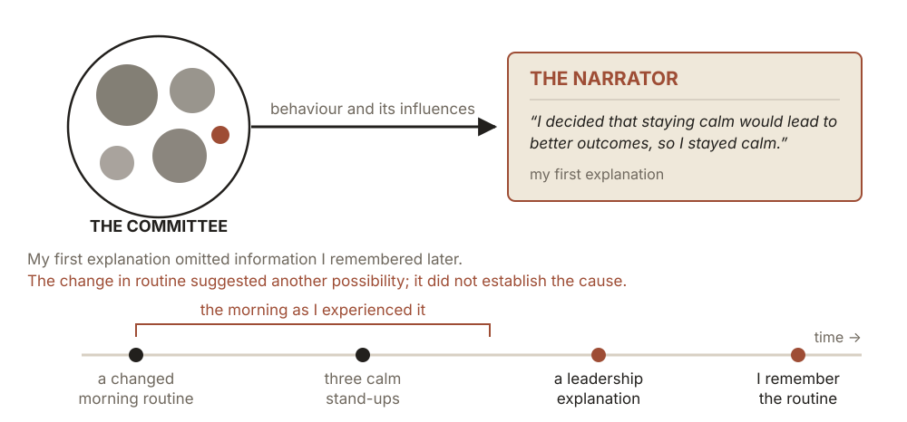
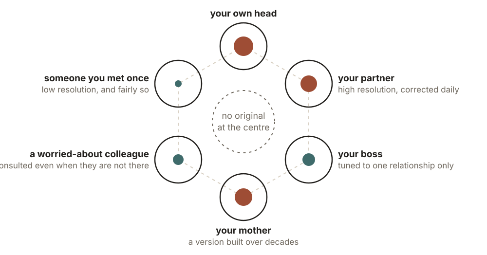
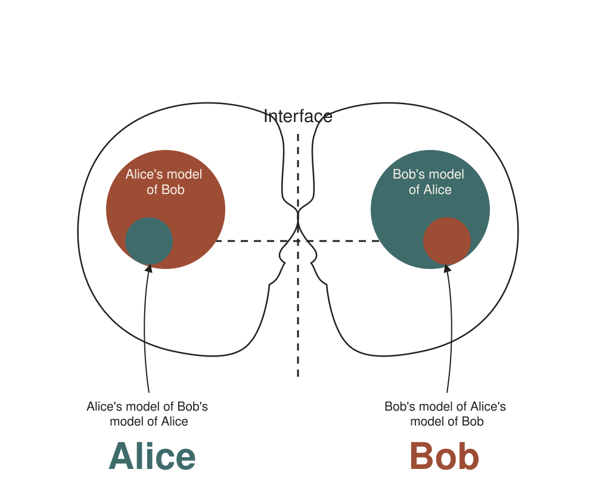
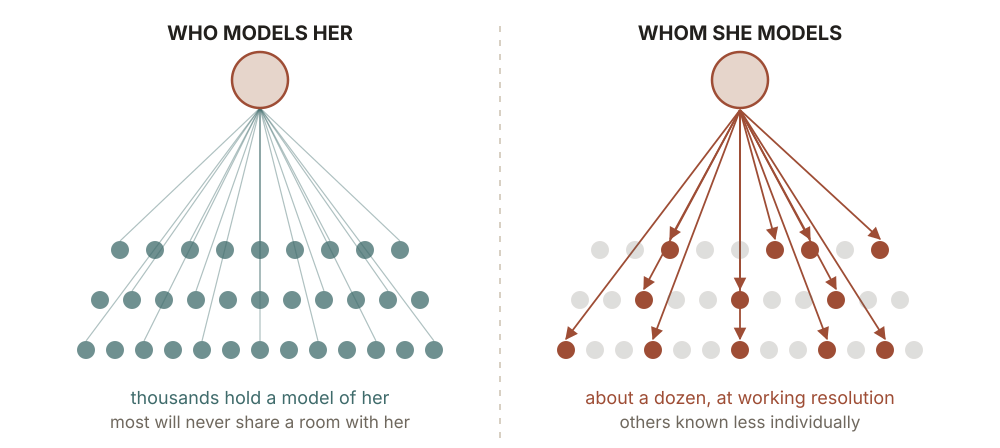
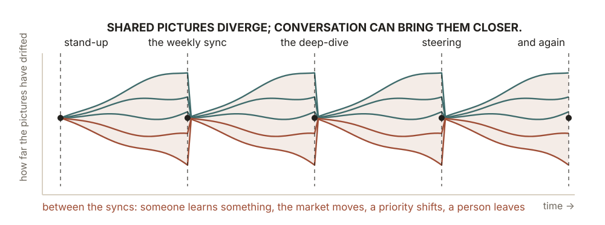
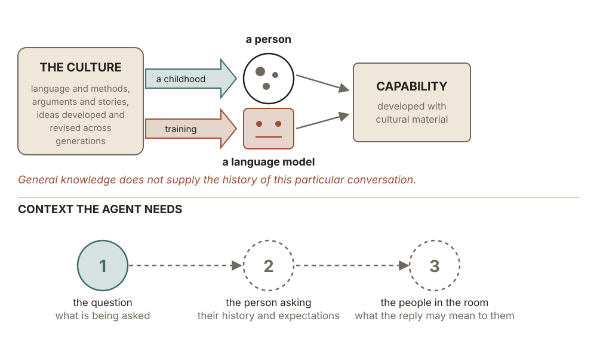
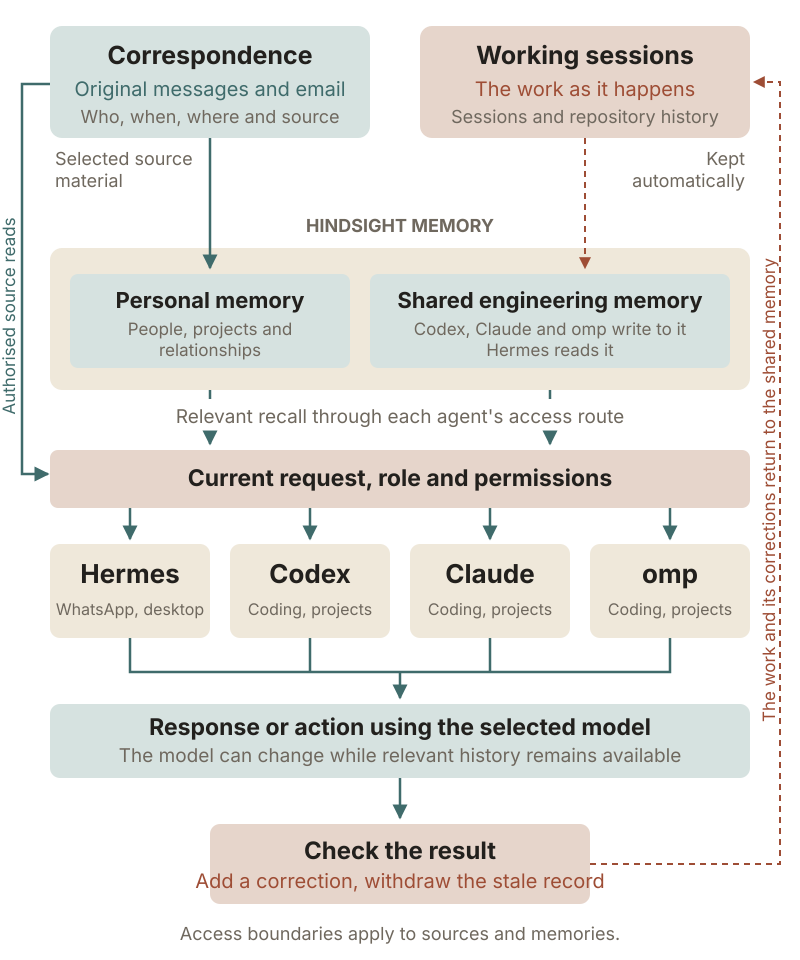

# **PEOPLING**
*How Minds Stay in Sync, and Why Everything Depends on It*

---

## Table of Contents

- Overview

**Part 1: Foundation**
*Understanding How This Actually Works*

- **Chapter 1:** Inside Your Head. Exploring You
- **Chapter 2:** Between Two Heads. Exploring Others
- **Chapter 3:** Across Many Heads. Most of Work Is Just Sync
- **Chapter 4:** The Smart Cultural Ghost. Exploring the Machine

**Part 2: Application**
*Solving for You and Your Organisation*

- **Chapter 5:** Solving for You. Meaning and a Congruent Self
- **Chapter 6:** Solving for the Corporation. Building Trust and Alignment

**Part 3: Implementation**
*Agents as Participants*

- **Chapter 7:** Peopling the Machine. Reading the Room

**Part 4: Synthesis**

- **Chapter 8:** The Path Forward

**Epilogue**

- The Universe Trying to Wake Up. The Philosophy Underneath

**Appendix**

- Quick Reference Framework

---

## Overview

A project can have a plan everyone has read and still have people working towards different things. The words are shared. The picture in each head is not.

A lot of what we call management is trying to close that gap. We explain, check, argue and tell the story again. I think it helps to see what we are actually doing in those conversations: building a model of what the other person understands, then giving them enough to update it.

That is the part of working with people that interests me. It ties into questions I have chewed on for years: how we build a sense of ourselves, how other people shape it and what an AI needs before it can work alongside us.

Sarah Perry uses the word *peopling* for what human beings do when they go about their lives together. Her [essay on the subject](https://ribbonfarm.com/2015/04/08/the-essence-of-peopling/) explores how our sense of self grows through other people, and how ritual and shared information keep that social world going. I take the idea to work, where understanding one another is a large part of getting anything done.

The book works through four scales: yourself, another person, an organisation and an AI agent. First, how the models form. Then what to do with them: get clear on your own values, choose and work with people you can trust and build systems that carry useful context between you.

*Across these four scales, one person's understanding becomes part of a relationship, then a group's shared picture. An agent can help maintain that picture when it has the context and permission to do so.*

Shared understanding will not fix conflicting interests, a lack of resources or a hard technical problem. It helps you see which problem you have. That is the practical promise here: a way to notice the assumptions people are working from, yours included, and do something about the gaps.

---

# Chapter 1
## Inside Your Head: Exploring You

When I was four, I thought Australia was in the clouds. My grandmother's plane went up into them, and she was going to Australia. With the information I had, that was a reasonable place to put it. Then someone showed me a world map and the model fell over.

I wrote about that on my [Thoughtmash blog in 2010](https://www.thoughtmash.net/2010/12/server-terminal-analogy-for.html). What struck me was how convincing a model can feel while it is wrong. We make sense of what we can see, and much of the work is done before we think to question it.

One of the models we build is of ourselves: what we want, why we acted, who we think we are. It can be useful and still leave a lot out. My way into that question was dreams.

## Reality is a controlled hallucination

Your experience of the world is shaped by memory and expectation as well as by your senses. One way to understand perception is as a running prediction: the brain guesses what is out there, then checks the guess against what comes in. Anil Seth calls this a [controlled hallucination](https://podcast.mindandlife.org/wp-content/uploads/2020/09/Anil-Seth_transcript.pdf): experience built by the brain and kept honest by what the senses report.

*The model generates an expectation; incoming sensory information can correct it. The diagram shows that feedback loop, not a measurement of how much perception comes from either source.*

I have had lucid dreams since I was a child: dreams in which I know I am dreaming. In my mid-twenties I started a diary and ran experiments. A dream let me inspect something that felt like a world while knowing my own head was generating every person and place in it.

The tests did not work the same way every time. Often I could fly. Text might look fine until I tried to read it. A reflection could distort or turn into someone else. A stranger could change if I watched too closely. I kept [dream notes](https://www.thoughtmash.net/2010/12/dream-world-flaws-which-are-useful.html). They describe my dreams. They are not rules for every dreamer.

What stayed with me was the comparison with being awake. Awake, I still have to interpret everything. The difference is that the world answers back. Another person can correct the version of them I carry. They can also surprise me in ways a model built only from my own expectations will miss.

## The committee in the driver's seat

In one lucid dream I was driving a four-wheel drive and decided to find out what a collision would do. I steered into oncoming traffic. Do not try the waking version.

I remember three things happening at once. I expected the other driver to react, and the car kept coming. I was terrified, even though I knew it was a dream. Then the cars passed through each other with no impact. My guess was that the dream had nothing in memory to build a convincing crash from. That is a guess about an experience. I had no way to inspect what my brain was doing.

Calm expectation, fear and the knowledge that I was dreaming were all there together, and they did not agree. That is why I like the image of a committee. It captures the experience of several processes adding up to what feels like one person: thoughts, reflexes, feelings and expectations, sometimes pulling in different directions.

There is now some evidence that the image fits the brain as well as the experience. In a 2026 preprint, [Jeremy Skipper and colleagues pooled 912 brain-imaging studies of the self](https://doi.org/10.64898/2026.11.12.766263): remembering your own life, recognising your own face, feeling that your body is yours. If one place in the brain did the job of being you, it should have shown up in all of them. None did. Each kind of task drew on a different mix of systems that also do other work, such as retrieving memories or sensing the body. The mixes were better described by how strongly each system contributed than by which ones were switched on. The authors call them shifting coalitions.

Some care is needed. It is a preprint, so it has not been peer reviewed. It compares published studies, not one person from moment to moment. The effects are small. But it suggests the committee has no permanent members and no chair. Who is in the room depends on what you are doing, and some voices are louder than others.

I get a quieter version at work. Part of me wants the deal. Part of me is uneasy and cannot say why. The unease is worth a look. It may have caught something I missed, or it may be a reaction the situation does not deserve. Either way, the first confident account is not always the whole one.

## The story is written after the fact

In [Benjamin Libet and colleagues' 1983 experiment](https://doi.org/10.1093/brain/106.3.623), electrical activity linked with preparing a simple voluntary movement began before people reported being aware of their intention to move. It is a striking result. By itself, it does not show that every considered decision is made before you know about it.

The interpretation is contested as well. [Schurger, Sitt and Dehaene](https://doi.org/10.1073/pnas.1210467109) later proposed a model in which fluctuations in brain activity help explain the average build-up before these spontaneous movements. So I will ask a narrower question. When you explain a choice, how much of the explanation was there while the choice was forming, and how much turned up afterwards?

I caught myself at this on a project I had been brought in to rescue. I was running several teams and, as usual, talking at a hundred miles an hour. One morning I ran three stand-ups feeling unusually slow and calm. Afterwards I told myself I had deliberately chosen a calmer approach because it would get better results. A leadership choice. Mature of me.

Then I remembered I had skipped my coffee and taken L-theanine that morning. One morning proves nothing about cause. What got me was that my explanation had turned up without either fact in it. I had taken the calm as evidence of a decision I am not sure I ever made.

*The morning described above: behaviour, an explanation, then a remembered detail that unsettles the explanation. This is a personal example of revising a story about a decision, not a universal timeline of agency.*

Sometimes agency feels less like turning a steering wheel and more like being in a boat. The wind changes, you find yourself heading east and then you decide east was where you wanted to go. Mood, habit, information and other people can all be part of that wind. Notice them and you have more to work with than if you assume every move began as a choice.

## When the explanation fills a gap

Confabulation is filling a gap in what you know or remember with an account you believe is true. The gap I care about here is why you did something. You give a plausible reason afterwards and never notice that it leaves out what set you off.

The neuroscientist Michael Gazzaniga studied this in people who had had surgery for severe epilepsy. Surgeons had cut the connections between the two halves of the brain, including the main bundle of nerve fibres that joins them, the corpus callosum. These are the people described as having a split brain. The operation let researchers show something to one half of the brain without the other half finding out by the usual route.

In one experiment, the researchers showed a picture of a chicken claw to the patient's left hemisphere and a snowy scene to the right. Then they asked the patient to pick related pictures. The right hand, run by the left hemisphere, pointed to a chicken. The left hand, run by the right hemisphere, pointed to a shovel. Both choices made sense. The claw goes with the chicken. The shovel clears the snow.

Then they asked why. The left hemisphere does the talking. It could explain the chicken, but it had not seen the snow. In [Gazzaniga's account](https://mmp.planetary.org/scien/gazzm/gazzm82.htm), the patient explained the shovel by saying, "you need a shovel to clean out the chicken shed."

The speaking half joined the shovel to the chicken because the chicken was all it had. The reason fitted. It also missed the snowy scene that had prompted the choice. Someone can sincerely explain their own action without knowing what caused it.

The ordinary version is familiar. We reach a conclusion, then get much better at explaining why it was right. Sometimes the explanation is sound. Sometimes it is a story that makes a preference easier to live with.

So ask what would change your explanation, especially when it flatters you. If parts of your reaction do not line up, slow down before you smooth them into one account. An open question can tell you more than a neat justification.

A language model does something that looks similar when it gives a fluent answer it has made up. The mechanism need not be the same for the comparison to matter. Either way, sounding right is a poor substitute for checking what supports it.

## You are the story, and you are not the only author

If part of your sense of self is a story you keep revising, you can work on it. You can question the account you give of a bad day, spot a pattern in how you react or decide an old role no longer fits. I come back to that in the chapter on meaning and a congruent self.

The story shifts with experience. A bad night's sleep, an argument at breakfast or a small win at work can change how you see yourself for the rest of the day. You may feel the shift before you can explain it. The committee reminds me to look for what the official story left out.

There is another question underneath. Where did you learn to tell the story? In his 1976 book, *The Origin of Consciousness in the Breakdown of the Bicameral Mind*, [Julian Jaynes describes an imagined "I" operating in a mental space](https://www.julianjaynes.org/book/ooc/en/consciousness/). You can put yourself into a conversation that has not happened, try an answer and picture what follows. His suggestion is that language helps build this ability. Metaphors give us a way to picture our own thoughts and work on them.

Think about rehearsing an email. The words you might send, the reply you expect, the person you are trying to be: you can revise all of it before anyone hears a thing. So the story can prepare an action as well as explain one afterwards. And you learned the language for it from other people.

The story may also do a job the committee cannot do for itself. If the membership keeps changing, why does it feel like one person from morning to night? The authors of the coalition study have a suggestion. Some of the same systems turn up again and again, and we keep using one word for whatever they are doing: this feeling is mine, I remember that, I did this. On their account, saying "I" does not report on an owner sitting behind the activity. It is one of the activities, and it is the one that ties the rest together.

That comes from their discussion. The scans do not show it. It is also a far smaller claim than Jaynes's and needs no ancient history. But it puts language where he put it: in the making of a self as well as the describing of one.

And the story is populated. There is the version of your boss you consult before you send the email, the partner whose reaction you can already hear, the colleague you are worried about. You can run a whole conversation with nobody else in the room. That is where the question leaves your own head and enters a relationship.

---

# Chapter 2
## Between Two Heads: Exploring Others

Think about the last time you rehearsed a difficult conversation. You wrote your own lines and the other person's too. How good the rehearsal was depended on the model you had of them.

Then the real conversation happens and the person gets a chance to surprise you. What matters is whether you let the surprise change the model.

Go back to the dream. The partner who appears there is built from your memory and expectation. They might do something familiar, or something the real person never would. Awake, you still read your partner through what you already know of them. But now there is someone independent of your expectations who can answer back. You can find out where the model is wrong, if you notice the correction.

A lot of misunderstanding starts in that gap: what I expected you to mean, and what you were trying to say.

## A person is a verb

The cleanest way I know to put it comes from Sarah Perry's essay on the essence of peopling, and what cracked it open for me was a point of grammar. She treats people as a verb, not a noun. A noun gives you a snapshot, a body standing there doing nothing in particular. The verb gives you what people are actually up to. Peopling is the whole catalogue: greeting, gossiping, joking, trading, flirting, mourning, jockeying for position. It looks like a thousand separate activities. Perry's claim is that they all run off one engine, and the engine is that we run on each other.

We usually picture it the wrong way round. We imagine a sealed self inside the skull that then, as an optional second step, learns to deal with other people. Perry, following the psychologist Philippe Rochat, says it runs the other way. You do not start as a private self and reach outward. You get built into a self by other people being aware of you, the way you only ever learn your own face from a mirror.

Descartes handed us "I think, therefore I am": the lone mind proving its own existence in an empty room. The older and truer version is "we think, therefore I am." The room comes first. The self precipitates out of it, like salt out of water left in the sun.

So who you are is not one thing in one place. It is distributed. There is the you in your own head, a version of you in your partner's head, another in your mother's, another in the head of someone you met last week. Each runs at a different resolution and behaves a little differently, exactly like those dream characters, because each is tuned to one relationship. You are one person with your mates, another with your parents, another on a first date. None of those is the real you wearing costumes. The self lives across all of them at once, and in the switching between them.

*You are not one thing in one place. A version of you runs in every head that knows you, each at the resolution that relationship has earned, and none of them is the real you wearing costumes.*

## The recursive mirror

Now make it precise. Coordinating with another person is not just me holding a model of you. It is a stack. My model of you. My model of your model of me. Your model of me. Your model of my model of you. And on down. In theory it runs to infinite recursion: the other person thinking that I think that they think. In practice nobody can hold the whole stack. The first few levels are enough to make a conversation complicated.

*Inside each person's model of the other sits an expectation of how the other sees them. Words, tone and timing cross the gap and can correct those expectations.*

The diagram makes it concrete. Inside Alice's head sits her model of Bob, and nested inside that, her model of Bob's model of her. Bob holds the mirror image. The two never touch directly. They meet at an interface, each working from the doll within a doll they carry of the other.

What matters about any of these models is its fidelity: how closely it predicts the real person it stands for. A high-fidelity model lets you call what someone will do before they do it. A low-fidelity one keeps getting caught out. And the deeper you go, the more you may be stacking guesses on guesses. That is one place to look when a conversation goes wrong. It will not explain every conflict. You can understand someone accurately and still want different things.

The second level matters when you decide how to speak. You think about what someone wants. You also think about what they believe you understand, what they expect from you and what your reply will do to those expectations. An answer can be correct and still miss the worry behind the question.

Holding these models can be tiring. I notice the cost when I try to remember names, places and who said what, the social fabric other people seem to carry easily. I am a strong in-the-moment thinker, but I do not reliably hold on to all of that history. Whether that is wiring, habit or a choice I made somewhere along the way, there is a limit to what I can keep in view.

There is a sharper reason it costs so much. The you that you carry from the inside runs warm and flattering, the lead in your own footage. The you that lives in other people's heads is cooler and more ordinary, a minor character in theirs. The two readings never reconcile. They are built from different information and neither can audit the other's books. The gap between them is more or less what self-consciousness is.

Attention makes it worse. The more you watch yourself being watched, the wider the gap opens. That is how a flash of self-awareness can spiral into the cringing kind, the kind that strangles whatever you were trying to do. Peopling does not hurt by accident. The ache is the cost of holding both selves at once.

There is a name for this whole structure, a loop that turns back on itself until a self falls out of it. Douglas Hofstadter called it a strange loop: a system that gets complex enough to model itself modelling itself, and in the closing of that loop an "I" appears. The recursion in this chapter is the same loop pointed outward, at other people. Keep the name. It returns before the chapter is out, and again at the very end of the book, because the loop that builds a self is also the one that lets a self keep running on a brain that was never its own.

## Other ways of imagining the self

The private individual steering everything from inside a skull is one way to picture agency. Other traditions pay more attention to the relationships and forces that act through a person.

The Iliad has a very direct example. Diomedes is a Greek warrior fighting at Troy, and Athena gives him courage for the battle. Samuel Butler's translation calls them Diomed and Minerva. Book V opens:

> Then Pallas Minerva put valour into the heart of Diomed, son of Tydeus, that he might excel all the other Argives, and cover himself with glory.

Later in the battle an archer wounds Diomedes in the shoulder. His companion pulls out the arrow, and Diomedes prays to Athena for help against the man who shot him. She answers the prayer, makes his limbs supple and tells him:

> Fear not, Diomed, to do battle with the Trojans, for I have set in your heart the spirit of your knightly father Tydeus.

Then it shows in what he does:

> When she had said this Minerva went away, and the son of Tydeus again took his place among the foremost fighters, three times more fierce even than he had been before.

Those are the words of [the Iliad, Book V, in Butler's translation](https://en.wikisource.org/wiki/The_Iliad_of_Homer_(Butler)/Book_5). Courage is something the goddess puts into him. He is wounded, asks for help, gets it and goes back into the fight. The change in what he can do is given a presence and a voice of its own.

The story of Saul is another version of something arriving in a person and changing how they act. An evil spirit troubles the king, and his servants suggest finding a musician. David is brought in and plays for him. [The account describes what happens](https://www.biblegateway.com/passage/?search=1+Samuel+16%3A14-23&version=KJV):

> And it came to pass, when the evil spirit from God was upon Saul, that David took an harp, and played with his hand: so Saul was refreshed, and was well, and the evil spirit departed from him.

Later the music belongs to a much darker scene. David is playing while Saul sits with a spear in his hand. [The story continues](https://www.biblegateway.com/passage/?search=1+Samuel+19%3A9-10&version=KJV):

> And the evil spirit from the Lord was upon Saul, as he sat in his house with his javelin in his hand: and David played with his hand.
>
> And Saul sought to smite David even to the wall with the javelin: but he slipped away out of Saul's presence, and he smote the javelin into the wall: and David fled, and escaped that night.

Saul tries to pin David to the wall. David gets away and the spear hits the wall. In the first passage Saul is well once the spirit leaves. In this one the spirit is there alongside his violence. The language pictures a person as open to forces that can arrive, act through him and leave.

That is what I like about these stories. I know what it is to have a mood arrive before I can explain it, or to have another person change what I feel able to do. The stories give that influence a shape. They cannot tell us exactly what an ancient person experienced from the inside.

## The voice that says I decided

Jaynes took the idea much further. [Brian J. McVeigh's defence of his theory, "Homer's Greeks had no inner life"](https://iai.tv/articles/homers-greeks-had-no-inner-life-auid-3724), proposes that people once experienced commands as the voices of gods and ancestors. Only later did a narrating self take over that authority. On this account, introspective self-awareness came out of language and cultural change around three thousand years ago. "Consciousness" has a narrow meaning here: being able to picture and narrate yourself from the inside. It does not mean being awake, perceiving or simply being able to think.

That is a much bigger historical bet than I need to make. Homer also gives us [Odysseus, left alone in battle, weighing whether to flee or stand his ground](https://beta.perseus.tufts.edu/urn:cts:greekLit:tlg0012.tlg001.perseus-eng4:11.384/). In Book XI, lines 401 to 410, he looks at the danger and talks himself towards a decision. How we read that passage matters, but it makes the claim that nobody had an inner life much harder to carry. A poem is evidence about how people described a mind. Getting from there to what every mind could experience takes another argument.

What I want from Jaynes is a question. Where do we learn the voice that says "I decided"? Think of asking what your father would say, or hearing an old manager's objection before you send a proposal. Someone else's way of judging can stay available inside your own thinking. That is ordinary peopling, whatever we conclude about Jaynes's ancient world.

McVeigh has a good word for what that voice supplies: authorisation. People look for something that permits an action or makes it legitimate. In his telling, the source moved over time from gods and ancestors towards the self. It can as easily be a leader or an ideology. I do not need his history to see the pattern. Asking what your father would say is a request for authorisation from a model of someone who is not in the room.

## A chariot with no owner

A different tradition takes the owner away altogether. In [a Buddhist dialogue](https://suttacentral.net/mil3.1.1/en/tw_rhysdavids), King Milinda challenges the monk Nāgasena, who has said that his name is only a convenient label with no permanent individual behind it. Nāgasena answers with a question about the chariot the king arrived in. Is the pole the chariot? The axle? The wheels? Each time the king says no. Nor is there some further chariot sitting alongside the parts. In the end the king agrees that "chariot" is the word we use when the parts are there together. Nāgasena says his own name works the same way.

Homer's gods act on a person from outside. This dialogue asks whether there was ever a single thing inside for them to act on.

It is close to the picture in the coalition study from chapter one, reached some two thousand years earlier and without a scanner. The researchers use the chariot themselves. I find the chariot a useful companion to Perry's grammar: a person as a verb, and a self as the name for parts working together.

In the interviews behind this book I wondered whether Protestant theology helped harden the individual-centred picture I grew up with. That is a hunch about history. It is not a complete account of where the modern self came from. It is also a different question from when people first learned to look inward. Ideas about individual responsibility can shift among people who already reflect on themselves. What I want to keep is that the picture can be questioned. You can take individual judgement seriously and still ask how a person's relationships help form it.

Bakunin made the political version of the point. Our awareness of ourselves is reflected through the people around us, and freedom depends on the freedom of others. In his [discussion of the individual and society](https://www.marxists.org/reference/archive/bakunin/works/1871/principle-of-the-state.html), recognition is part of freedom. It is not a limit placed on an otherwise complete, isolated person. That is another road into the relationship this book explores.

## Carol, who kept running

Douglas Hofstadter pushes the distributed self about as far as it will go, and he does it through grief. In *I Am a Strange Loop* he writes about his wife, Carol, who died suddenly when their children were small. His way of living with it is not a consolation. It is a claim about what a person actually is. A person, he argues, is a pattern, not a lump of matter, and a pattern can run on more than one brain.

Over their years together, a low-resolution copy of Carol had been installed in him. Her values, her way of seeing, the precise way she would have reacted to a given thing. When she died, that copy did not switch off. It kept running. He could still feel her weigh in on a decision, still catch the world for a moment through her eyes, because a real part of who she was had always lived in his model of her, and that part survived the loss of her body. It is a coarser version than the one that ran on her own brain. It is still, recognisably and genuinely, her.

Hofstadter is claiming that a person continues through patterns held by others. Take it literally, or take it as an account of how someone keeps shaping a life. Either way the experience is recognisable.

Even alone, you may consult a parent, a mentor or a friend in your imagination. The answer you supply can let you test an idea against a view other than the one currently on top in your mind.

At the extreme, Joshua Slocum described a vivid imagined companion on his solo voyage. While ill, he experienced a visitor who introduced himself as the pilot of the Pinta. His [own account](https://www.gutenberg.org/files/6317/6317-h/6317-h.htm) is memorable. It should not be made to prove a general theory of who survives isolation.

The smaller, everyday claim is enough: a conversation with an imagined other can do useful work. It can also hand your own assumptions back to you, because you are writing both sides. A real person offers something the rehearsal cannot promise: a correction you did not write yourself.

## Models with nobody home

Once you see it, you catch yourself doing it constantly, with people who are not in the room and a few who are not anywhere. You ask yourself what your father would make of a decision. What a mentor would say. What Jesus would do. You are regulating your own behaviour against a model of a person who is not present, and it works, because the model is doing the work, not the person.

A great deal of religion is exactly this: a high-resolution model of someone you revere, kept running and consulted before you act. The prayer, the re-reading, the weekly gathering are not separate from the model. They are maintenance on it, the same upkeep a friendship needs, because a model you stop feeding will drift and fade.

And it is the same machinery whether the other person is alive across town, long dead like Carol or never real in the first place. We are built to keep other people partly alive inside us and to let them steer what we do. Which, when you actually sit with it, is a strange and slightly miraculous thing for a brain to be doing. We do it without noticing, all day long.

## Trust needs more than a good model

Keeping a relationship going means keeping those models current. Ritual and regular contact give people the chance to notice what has changed. Without them you can end up responding to someone as they used to be, or as you assumed they were, and you miss the person trying to talk to you now.

A higher-fidelity model tells you more about what someone is likely to do when you are not in the room. That matters for trust. It is not trust. You can know someone very well and know perfectly well that you should not rely on them. The better model might be the reason you decide not to work together.

You also need values that line up: enough common ground about what matters and how you treat each other. If I care about keeping a promise and you think a promise expires when a better offer arrives, understanding you more accurately will not close that gap. We do not have to agree about everything. We need enough alignment on the things the relationship depends on for me to be comfortable relying on you.

That is part of what the long dinner that barely mentions the deal is for. The apparently random talk gives you a richer model of someone, and a sense of what they actually value. Over time their choices tell you whether the picture holds. Sometimes you find you want to work together. Sometimes you find out why you do not.

All of it still has to cross the same narrow channel between two heads: language, expression, tone and time spent together. Every conversation gives the model another chance to be corrected. Widen the channel and you can learn more about the person, a thought worth holding onto for the end of the book. What you learn is not guaranteed to make you trust them more.

And because the modelling runs both ways, you do not hold your own shape on your own. Spend enough time with someone and the two of you converge, each quietly editing the other's model and, over time, the other's self. Their habits, interests and ways of thinking can become part of yours, which is a good reason to be deliberate about who they are. You are not just choosing company. You are choosing who gets to reshape you.

There is a name for what all of this amounts to, and it is worth stating cleanly before we scale it up. Personhood is a coordination layer. It is the protocol the group runs so that separate minds can predict each other well enough to act together. The self does not emerge first and then join the group. It emerges because the group needs something stable enough to model, and what it models into existence is you. The recursive mirrors, the dream characters, the trust built over years of contact: all of it is the coordination layer doing its work. It turns the noise of a human animal into something another human animal can rely on.

A team makes the problem harder. People need to understand one another well enough to work together, while keeping track of a project no single person sees in full. That is the next scale.

---

# Chapter 3
## Across Many Heads: Most of Work Is Just Sync

In a team, the models take in relationships, responsibilities and a picture of the work itself. As the group grows, personal contact stops being enough to keep all of that in sync. So the group builds things to hold it: plans, roles, meetings and shared accounts of what matters.

## You don't have a personality, you have one per room

Start with Perry's version of the multiple self, because it scales straight up into organisational life. Each person, she writes, has a different self for each of the people he knows, and a different self for every social context. A teenager behaves, speaks and thinks one way around his friends and an entirely different way around his grandparents. The self at work is not the self at home with close friends, or in bed with a partner. None of these is the true self. The self exists in all of them, and in the transitions between them. To collapse them into one flat public self, she says, would be a kind of social death.

That is exactly the right frame for work. You do not have one personality at work. You have one per room. There is a finance-director self, a worried-about-the-board self, a mentor-to-the-juniors self, and they are genuinely different people, with different voices and different things they care about, because each is tuned to a different group. This is not you being fake at work. It is what having a self among many groups looks like. The trouble only starts when one of those selves stops being something you inhabit and hardens into a costume you wear. We will get to that.

There is a small piece of brain evidence that the room matters. In [a 2010 imaging study](https://doi.org/10.1162/jocn.2009.21192), Joan Chiao and colleagues nudged bicultural participants towards either an individualist or a collectivist frame, then asked them to judge statements about themselves. Regions along the middle of the brain, often linked with thinking about yourself, responded more to general descriptions after the individualist nudge. After the collectivist nudge they responded more to descriptions tied to a situation. The frame people had been put in changed how their brains handled the question of who they were.

## Status is the thing everyone is actually tracking

The next thing that scales up is status, and Perry is sharp on it. We do not model everyone equally. We spend our modelling budget by position. Our social superiors, the ones with power over us, get a large share. So do our possible enemies. And so do the people just below us who may be jockeying for our position. They have to be simulated in detail precisely because they are coming for the rung we are standing on. Keeping your own accurate place in that web, Perry says, including your status and your relationships, is the core task of being human.

Scale that up and a hierarchy turns lopsided. Thousands of staff may carry a model of a chief executive who knows relatively few of them individually. They need to anticipate her decisions. She cannot give each of them the same attention. An org chart is partly a map of that unequal need to understand other people. A restructure can disturb it, and people have to work out again whose judgement matters and what the new relationships mean.

Public shaming is the darker setting. A crowd can hold a flat, hostile picture of someone who cannot answer each person or correct each version. The person is intensely visible without being well understood. Attention is one thing. The fidelity of the models people hold of you is another.

*An illustrative hierarchy: many people attend closely to one person who knows fewer of them individually. The numbers show the asymmetry, rather than a measured rule about executives.*

I first noticed a simpler hierarchy on a farm. As a kid I moved cows between paddocks and watched them fall into a familiar order: a head cow, a second, then the rest behind. It made me wonder how much of leadership is filling a role the group needs. Somebody sets a direction and the others respond. A herd does not explain an organisation. But the memory helps me question the idea that leadership belongs entirely to an exceptional individual.

This is the coordination layer from the last chapter showing its other face. The same process that builds a self also limits it. To be someone the group can coordinate with, you have to be someone the group can model, and that means staying roughly where they put you. The modelling budget is not free. People spend it on you, and the unspoken return is that you stay predictable enough to justify the investment. Change too fast or too far and you force everyone around you to rebuild their models from scratch. That is expensive, which is why they push back.

The coordination layer does not only produce the self. It polices it. Personhood is the price of being legible enough for others to work with, and the price is that other people get a quiet, persistent vote on who you are allowed to be.

## The corporate skinsuit

Here is where one of those selves can curdle, and Perry has the perfect word for what it becomes. She describes the bureaucrat you have to deal with as a skinsuit: the suit the corporation or the agency wears, with nobody inside it who is fully present and modelling you back. You have met this person. You have, on a bad week, been this person. Someone shows up as the stiff corporate version of themselves, nothing like who they are at the pub, and holds that rigid shape all day.

I think this helps explain why companies put so much effort into values statements. They are trying to give the work-self a common set of expectations, so people can cooperate without first learning everything about one another. It is a useful shortcut. You can know very little about a colleague's private life and still expect them to keep a commitment or tell you when something has gone wrong.

The cost arrives when the work-self is a rigid performance of values the person does not hold, or that the company says it holds and quietly rewards people for ignoring. Then the suit hides the disagreement when it should be helping people work through it. You get a low hum of dissonance in the person wearing it, and doubt in everyone else about whether the stated values mean anything. The later chapters come back to both sides: how much of yourself you need to perform, and how a team settles on values it can rely on.

## A company is a shared hallucination you maintain together

Past a certain size, two-way modelling simply breaks. You cannot hold a live model of five hundred people each holding a model of you. It is hard enough between two. At the scale of an organisation, people need other ways to coordinate. So the group does what humans always do with something too big to model directly. It builds a shared entity and points everyone at that.

The company, the brand, the mission and the project give people something common to steer by. Perry uses the word *egregore* for an entity that lives in the thoughts of a group and can, in turn, influence the group. A company is a practical example. People carry different accounts of what it stands for and try to act on its behalf. I call it a shared hallucination to point at that collective act of imagination. The contracts, assets and people are real. The common purpose lasts only as long as people keep recognising it and taking part.

The crowds in my dreams gave me an image for this. I often experienced a crowd as having one mood or direction, with no way to deal with its members one by one. You can meet an organisation the same way, as a collective with its own momentum. That describes the experience. It does not mean the individuals inside a company disappear or behave like dream characters.

## Most of work is just sync

Sit through a week of corporate meetings and watch how much of the time goes into getting people to understand the same thing. The stand-up, the status update, the technical deep-dive: each can exist so people leave with a clearer picture of what is happening and what to do next. I have sometimes put the proportion at ninety per cent. That is an impression from my working life, not a measured statistic. The point is how easily we treat coordination as an interruption while depending on it all day.

And the picture will not hold still. The moment you have everyone aligned, someone learns something new, the market moves, a person leaves, a priority shifts, and the shared model starts drifting apart again. In a technical field it is worse, because the thing you are trying to get from one head into another is hard to explain, so the cost of keeping it in sync climbs.

You are not failing at your job when this eats your week. This is the job. We just never named it, so we treat the thing that consumes most of the working day as an interruption to the real work, when it is the real work.

*New information and changing circumstances pull people's pictures apart. A useful conversation can bring them closer again; a meeting only helps if it changes what people understand.*

Think about a live traffic map. Information from many journeys can add up to a picture no single driver holds. You cannot see the jam four streets ahead. A map may help you act on it. That is what I mean by shared context: separate contributions assembled into something useful beyond the person who supplied each one.

A maps app makes the coordination visible. Each driver contributes to a picture nobody could assemble alone. In an organisation the information is spread around in the same way, but much of the effort goes into rebuilding it in meetings, over and over. That suggests a job for a system that can keep the shared record and find the right part of it.

## Teams form by renegotiating who everyone is

This is also why a team cannot simply be assembled and switched on. Drop into a project that has gone sideways and you watch a group march straight through the old textbook stages: forming, storming, norming, performing. The storm gets blamed on personalities, but it is not really personalities. Everyone is re-adjusting who they are relative to everyone else. They are rebuilding the status hierarchy and working out who each person is going to be inside this particular group. It goes on until the group settles into something that can run. It looks like friction. It is personhood being negotiated in real time, the selves and the status from the start of this chapter all getting sorted out at once.

What makes a settled team fast is what we called trust in the last chapter, scaled across a group. You need models of one another good enough to predict what each person will do when you are not watching. You also need enough shared values to be comfortable relying on those choices. That helps explain why a person who can get an idea cleanly from one head into another is worth so much. The strongest communicator and the strongest individual executor may be different people. The team needs both.

## We used to get this for free

Shared experience used to do some of this maintenance without a calendar invitation. Spend time alongside people and you pick up how they work and what they mean, just from ordinary contact. A distributed team has to create those chances on purpose. Tickets and scheduled calls carry important information. They may leave little room for learning the person behind the role.

I see a version of this outside work too. People can be well connected and still spend their days in very different information environments. Each person's feed supplies a picture of what matters that others may barely recognise. I do not know how much of the apparent fragmentation is the world changing and how much is my own feed talking. That is part of the problem: even my impression of the shared picture comes from somewhere particular.

The idea sometimes called the cult of the self interests me here: the pressure to maintain an individual identity for an audience. It can eat your attention without ever giving you the experience of being understood. So the question for this book is practical. Which relationships give you a chance to be recognised and corrected, and which only keep you performing?

Perry describes the difference between going unrecognised and feeling socially substantial. She means being held in other people's understanding, so you do not have to keep establishing who you are. A familiar community can give you that. So can a team or a friendship built over time. Formal connections alone do not guarantee it.

The useful skill is following a view you disagree with well enough to see why someone holds it. You may never agree. At least you will know where the disagreement is, and stop arguing with a position the other person does not recognise.

What happens when an AI joins that exchange? It may know a great deal about the subject and very little about the people and the history behind the question.

---

# Chapter 4
## The Smart Cultural Ghost: Exploring the Machine

A model can give a capable answer and still have no useful picture of the situation it is answering into. It may not know what this team decided last week, why someone is asking again or what they already understand. That is the gap I want to explore. First, though, a question about where its ability comes from.

## The culture is part of the intelligence

When a machine does something clever, it is tempting to look for a clever individual inside it. I think that misses how much of the intelligence on show comes from the culture it learned from. We make a similar mistake when we give one human all the credit for what they know.

A child inherits language, stories, methods and distinctions that took many people a long time to work out. I can reason about things I could never have discovered alone, because other people made those ways of thinking available to me. Individual ability matters. It works on material supplied by a much larger collective effort.

A language model gets to that material by a different route. Training on the records people have left gives it the patterns in other people's language and work. That is not a childhood. But the comparison helps me see the cultural contribution in both cases. Intelligence is partly in the library we share, not only in the person consulting it.

It runs both ways. We use language to express thought, and the language we inherit helps shape what we can express. A friend pushed back when I called people mouthpieces for cultural intelligence. Surely language was the mouthpiece for our intelligence. I think both are true. We absorb the common material, use it and change it.

## A smart cultural ghost

That is what I mean when I call a language model a smart cultural ghost. It can draw on an enormous amount of human expression and speak in many registers without having lived any of what it describes. The phrase keeps its fluency and its unfamiliarity in view together.

The old idea of a spirit speaking through someone is another way to picture it. A voice can carry more than the experience of the individual producing it. I am borrowing an image. I am not claiming ancient people would have understood modern computing. What interests me is the possibility of something taking a useful part before we have settled what, if anything, it experiences.

## What we can ask it to do

My own hunch is that the model is something like a philosophical zombie: it produces intelligent behaviour with no subjective experience behind it. I cannot prove that. The question is unresolved and the system's performance does not settle it. The practical argument here does not depend on it.

Jaynes's narrow use of "consciousness" helps here too. A system might describe itself, rehearse a conversation and give reasons for a decision. We can inspect those abilities without knowing whether anything feels like something to it. If an agent says "I thought you meant", I want to know what information led it there and whether it can revise the assumption. The first person in the sentence does not answer the question about experience.

McVeigh, in the article from chapter two, is clear that Jaynes would not have applied his term to a machine. On that account the narrating self is built through language used by people with bodies and lives. A model has the language without the life. It inherits the vocabulary of an inner space second-hand, which is close to what I mean by a ghost.

The two come apart in people as well. The coalition study from chapter one reviews research in both directions. A person's own name, shown too briefly to be consciously recognised, still speeds up their responses to the names that follow. Experienced meditators describe awareness continuing while the sense of being someone fades. Handling information about yourself is one thing. Having an experience is another. An agent's fluent "I" is evidence of the first. It tells us nothing about the second.

So the questions I can do something with are more specific. Can it hold the relevant context? Can someone correct it and have the correction survive the conversation? Can it say what evidence it used? Can it keep one person's information out of a room where it does not belong?

Those are things we ask of any reliable participant. If personhood is a set of jobs done among other people, I can test the system by building it and using it. The question of experience stays open.

## What the ghost has not been told

The model may have learned a great deal about people in general. That does not mean it knows the history of these people, on this project, right now. It can infer something from the question and whatever else is in the conversation. The missing information may be the reason the question was asked at all.

Think back to the nested models in chapter two. To answer well, an agent may need a picture of the asker, of what the asker expects from it and of what its reply is likely to do in the group. Give a system that context and it can attempt the task. A system that never received it may fill the gaps with plausible assumptions.

*Training supplies general patterns. The people, history and expectations of this particular conversation require additional context. The lower row shows information a system may be missing, rather than a fixed limit on what a model can do.*

That difference is the starting point for the agent in chapter seven. Before building it, I want to look at the human side: how to get clearer about your own values, and how a team builds enough shared understanding to act together.

---

# Chapter 5
## Solving for You: Meaning and a Congruent Self

You can spend a day in meetings doing two jobs at once. There is the project. Then there is keeping track of who you think each person expects you to be. You shape what you say around a guess about the version of you in their head. That second job can be exhausting.

Some of that attention helps the conversation. Some of it goes into winning approval, or defending a position you no longer believe. It is worth finding out which part is costing you, because having several selves is not, by itself, the problem.

## Different relationships need different parts of you

Sarah Perry makes the limit explicit in [The Essence of Peopling](https://ribbonfarm.com/2015/04/08/the-essence-of-peopling/):

> There can never be one single, public self; to collapse all these multiple selves together would be akin to social death.

Her point is that a self exists across relationships and in the movement between them. No version has an exclusive claim to being the real one. The differences are part of what makes each relationship possible.

The coalition researchers from chapter one make a prediction I find useful here, and it is a prediction, not a result. They expect wellbeing to go with being able to enter one arrangement of the self, stay in it and leave when circumstances change. Rumination, on that view, is a self-critical arrangement you cannot get out of. That is the skinsuit from chapter three seen from the inside. The trouble was never having a work-self. It is being unable to take it off.

Being a colleague, a close friend and a partner takes different kinds of attention and intimacy. Privacy matters. So do the responsibilities of a role. Some things you can properly share with one person would be out of place with another. A professional manner can be useful and sincere, even when it is nothing like how you are at home.

There is also a limit to what you can settle on your own. Other people have their own histories with you. They will keep different pictures of you, and you cannot make those pictures match by deciding to be more consistent.

So the change I am after is narrower: fewer contradictions kept alive to satisfy different audiences. Congruence, as I mean it, is being able to stand behind your commitments in every room, while accepting that the rooms ask different things of you. Some tension will stay, because some demands really do conflict.

## Choose the conflicts worth changing

I see it most clearly in consulting. Agreeing with the client can feel like helping, until you find yourself backing a direction you think will fail. Now you are doing the work and keeping your judgement out of it. The better move is to explain the concern and what it rests on, in a way the client can hear. That still takes tact. It also leaves room for the client to know something you have missed.

A friend gave me an image I like. She thinks of herself as a planet, with a core and looser layers around it. Different people draw different material to the surface. That makes room for both stability and variation. I can want my commitments to be dependable without expecting every conversation to bring out the same part of me.

Conviction helps when it rests on reasons you are willing to examine. It gives people something to learn about you. It does not mean defending yesterday's position after the facts have changed. Being able to say why you changed your mind may make you easier to trust than performing certainty.

I have spent years bringing my work personas closer together, and I find it less tiring. That is a result for me. It is not a prescription to expose every part of yourself at work. It has also been easier with a reputation and a body of work behind me. Someone whose position is less secure may have good reasons to stay guarded.

There are costs either way. Speaking plainly can surface a disagreement that politeness had kept out of view. You may find that a role asks you to support something you cannot stand behind. That is a real choice about the work or the relationship, and consistency will not make it go away. Nor does everyone who understands you have to share your values.

## Give the projects a direction

The more useful question, especially where the selves cannot be brought together, is what connects the things they are doing. In a supplementary interview I put it this way: at least try to bring the meaning together.

I know the pattern. I finish a project, find myself with time and go looking for the next thing to keep my mind busy. Busyness makes it easy to avoid asking what any of it is for. The next task supplies an answer just long enough to get started again.

The computing analogy that came to me was a sub-agent. Each project loads a subset of you and points it at a goal. You can be very effective inside the task while the wider question goes unattended. I called that being AFK, away from the keyboard, in your own life.

You cannot keep every part of yourself running at once. What you can do is step back from the task now and then and ask how it fits with something you care about beyond finishing it. Would it still matter if nobody were waiting for the result? What part of your life keeps getting postponed while you finish one more thing?

Meaning does not have to be one grand purpose shared by every role. You may care about doing useful work, being present for the people you love and making something simply because it interests you. Those purposes can support one another. Sometimes they compete. Naming the trade-off beats pretending everything serves a single mission.

The point is to have some say in what your activity adds up to. A company's goal may be worth working towards. It cannot answer every question about what matters in your life. Finishing the project should leave you with more than the need for another project.

That brings us to the people you work with. How do you build a team where different people can serve a shared purpose without having to become the same person?

---

# Chapter 6
## Solving for the Corporation: Building Trust and Alignment

A team brings together people with different histories, priorities and assumptions. You can be clear about your own values and still not know how everyone else will behave under pressure. Leadership involves learning those differences and building enough shared understanding to work with them.

Some of that work happens in a project meeting. Some happens in a conversation that barely mentions the project. Both can matter. The test is whether the contact helps people understand, decide and act. How productive it looks on the calendar is beside the point.

I will take trust and values first, then the everyday contact that maintains them, then how a group builds a shared picture of its work.

## Trust needs understanding and shared values

The kind of trust I want in a team has the two parts we separated in chapter two: a model of someone good enough to know how they are likely to act, and enough shared values to be comfortable relying on them. More contact helps you learn who they are. It does not guarantee that what you learn will make you want to work together.

A shared vision gives you a picture of what you are trying to do. Shared values matter when you have to choose how to do it, especially when something goes wrong or two priorities collide. You can agree completely about where the project should end up and still disagree about whether it is acceptable to hide bad news, break a promise or leave someone else carrying the cost.

This is why sales involves long dinners that barely mention the deal, and why companies arrange team-building that has nothing to do with the work. You get to see more of someone than the version who turns up with a status report. The apparently random conversation helps you build a higher-fidelity model, including a sense of what they value. That makes it easier to judge whether you want to rely on each other. The dinner can help you discover alignment. It cannot manufacture it just because you both had a good time.

Values also have to survive the incentives people face. A team can share a vision and sincerely endorse the same principles, yet reward each person for decisions that make someone else's job harder. When a KPI rewards withholding information or protecting your own result at the group's expense, a dinner will not fix it. People learn from what the organisation rewards as well as from what their colleagues say.

## What a values statement is trying to do

A company cannot wait for everyone to build a detailed model of everyone else before anything gets done. I think that is part of what a values statement is trying to shortcut. It gives people a common account of how they are expected to behave at work: keep your commitments, be honest about mistakes, take responsibility for your effect on others. A new colleague is meant to arrive with some of that alignment already in place.

In the language of chapter three, it is aligning the values of the corporate skinsuit. You might be thoroughly depraved outside work, but the company still expects the version of you that turns up on Monday to follow the same rules as everyone else. It does not have to reconcile your whole private life with theirs. It is trying to make the work-self something other people can rely on.

But it is better when the values hold outside work as well. Then the company is asking you to act in a way that already makes sense to you, and your colleagues can rely on something that belongs to the person as well as the role. You have less to perform, and they have less reason to wonder which version of you they are dealing with. That is the link back to the congruent self: the smaller the gap between your values and the values your work asks of you, the less energy goes into maintaining it.

The statement is still a useful start, as long as the words describe what actually happens. If the poster says honesty and the person who raises a problem gets punished, people learn from the punishment. The values that matter are the ones that show up in decisions, particularly when following them costs something. A statement can give you a first model of what to expect. Working together is how you find out whether it was accurate.

## Other ways of binding a group

There are other ways to make people confident that someone will not betray them. Take a gang that requires a new member to commit a crime. The act can create shared exposure: each person now has something to lose if the arrangement falls apart. An initiation or hazing ritual can do a related job. It makes membership costly and gives the group a shared experience or a shared secret. Where people cannot afford to have the secret exposed, betrayal becomes expensive. It is a shortcut to a particular kind of trust, built by tying people's interests together.

What matters is the binding mechanism. Shared exposure can let people rely on one another without first building a detailed model of each other's values. It does not make betrayal impossible, and it does not tell you how they would behave once the cost of leaving changed. The arrangement is doing some of the work that shared values would do in another relationship.

A cult of personality gives a group another point to align around. A founder or CEO can become the person who carries the vision and embodies the values, especially in a startup where so much of the company is still an extension of its founder. You might barely know the person beside you, but you both believe in the leader, and that gives you a starting reason to believe in each other. The lopsided attention from chapter three is doing the coordination: everyone can model the same person without first modelling everyone in the company. The leader also becomes the group's source of authorisation, in the sense from chapter two: people act because the founder would approve.

That can bring people together fast, but it matters what their loyalty is attached to. If it is attached entirely to the leader, questioning a decision can start to look like disloyalty to the group. If it is attached to values the leader is expected to uphold too, those values give the group a basis for disagreement and correction. A team can look aligned in both cases. You find out which kind it is when someone needs to say the leader is wrong.

## The stuff that looks like a waste of time is the work

Informal conversation carries information the formal channels may leave out: what someone notices, how they respond to disagreement, what else is going on in their life. It lets people become more than the role they occupy in a meeting.

A distributed team can lose some of that ordinary contact when every exchange is a ticket or a scheduled call with an agenda. The work still gets done, but people may have fewer chances to learn how to work with one another. If that is happening, it needs a deliberate response.

I value being able to see people in a conversation. Expression and the small signs of a reaction can help me notice when something has not landed. But a camera is only one source of that information. A black tile does not tell me whether someone is paying attention, taking responsibility or feeling able to speak. The aim is to make it possible and worthwhile to take part, then notice who is still not being heard.

A small, informal call can help. Put three or four people together for fifteen minutes with no project agenda and let them talk about the weekend, football or the price of eggs. The topic can be ordinary. The point is to learn something about one another that the status report does not contain.

Keep an eye on whether people actually find it useful. A small group gives everyone room to take part. A compulsory performance of sociability can leave them doing exactly the extra work the previous chapter described.

People also need room to speak without every unfinished thought becoming a permanent public position. Agreeing on what stays within a conversation helps, as long as the group honours it. Otherwise people have good reason to offer only the carefully managed version of themselves, and the chance to learn more is gone.

## Alignment is a shared picture, held on purpose

As well as understanding the people, the team needs a shared picture of what it is doing and why. That is what I mean by alignment. It includes knowing where people disagree, because an unspoken difference in assumptions can look like agreement until somebody acts on it.

A useful vision often comes out of people comparing their pictures and someone pulling them into a form the group can recognise. Talk first, then try to state what the work is for. People need a chance to say what that account misses.

The quality of the disagreement matters. If the chair asks for debate after the answer has already been decided, the meeting can produce a show of agreement and leave everyone's real view untouched. The same thing happens whenever it is safer to nod than to explain a concern.

Steering committees and workshops can do real work here. They bring competing assumptions into the open while there is still time to change the plan. Ask what a decision depends on, who holds different information and what would make the group reconsider. That gives the discussion a job beyond confirming that a meeting took place.

The picture needs revisiting as the work changes. New information, a departure or a shift in priorities can make yesterday's agreement incomplete. A recurring forum is useful when it exposes that change and lets people respond. Repeat the same story without checking that it still fits and you can keep the look of alignment while the work moves somewhere else.

## Tell the story, not the model

An explanation has to give the listener a way into the idea. Hand over every detail at once and you can bury the decision they need to make. A story or a concrete example can show what matters. The detailed model can wait until they need to examine it.

Watch a complicated delivery and you will often find someone translating between specialists who are talking past each other. They explain why a technical choice matters to the person paying for it, or why a constraint that looks minor to one team changes the plan for another. That is part of the work I recognise in consulting: moving understanding between people who do not start with the same picture.

Pace matters. If I deliver my full belief system at a hundred miles an hour, the other person may spend the conversation trying to keep up, or defending a position I have barely understood. It works better to start with what the listener already holds and build from there.

The apostle Paul [wrote](https://www.biblegateway.com/passage/?search=1+Corinthians+9%3A19-23&version=NIV), "I have become all things to all people". One of his examples was, "To the Jews I became like a Jew". He was explaining how he adapted to people with different customs and obligations while trying to bring them to his faith. What I take from it is that you have to give someone a way into an idea from where they already are. You can stay committed to what you believe while changing the language, the examples and the starting point you use to explain it.

I have used the word *propelling* for the wider work of helping an idea take root: the relationship, the timing and the framing as well as the argument. Peopling helps you understand the person and the situation. Propelling is what you do with that understanding when you try to move an idea forward.

It is still an exchange. If the other person can only absorb your view and never change it, you are missing part of what the conversation could tell you. A better shared picture may need both of you to revise what you brought in.

## Why it never holds still

The work keeps changing, so alignment is something you maintain. You never reach it once and keep it. The practical question is what needs revisiting when new information arrives, and which relationships have stopped carrying what people need to know.

I have seen this when joining projects that needed rescuing. People were trying to work out who held authority, whose judgement to rely on and how their own role fitted into the new arrangement. A disagreement about the plan could also be a disagreement about those relationships.

An offsite can give people time and a different setting to work through it. A reorganisation can force a similar rethink at a much higher cost. Neither guarantees a better shared picture. What matters is whether the people involved can build one, and whether the new arrangement helps them keep it current.

## Who you put in the room

This is why choosing who to work with matters as much as learning to read the people already there. Look for enough alignment on the values the work depends on. If you think a promise matters when it becomes inconvenient, work with people who think so too. If you want bad news raised early, watch how someone responds when they receive it. Their choices tell you more than agreement with a list of admirable words.

That still leaves plenty of room for different ideas, backgrounds and ways of solving a problem. People can disagree strongly about the plan while sharing a commitment to being honest about its weaknesses. That kind of disagreement helps the work. A disagreement about whether honesty matters is a different problem, and better communication alone will not fix it.

Because models adjust in both directions, the people in a group also reshape one another over time. Who is in the core group is a decision about who gets to influence whom. Choose people whose judgement and values you are willing to have rub off on you, as well as people who can do the job.

One of the skills to value is carrying understanding between people. The strongest individual executor may not be the person who can explain a decision across the whole team. A group needs both, and it helps to recognise the coordination work out loud.

All of this takes attention and time. A system that keeps the record and helps people find the relevant part could cut some of the repeated explanation. That is the role I started exploring with an agent: supporting the relationships and judgement in the group by making its context easier to work with.

---

# Chapter 7
## Peopling the Machine: Reading the Room

While preparing this book in June, I asked the agent to organise the material. It moved the main manuscript into the folder for working documents. By its account, the repository had been tidied. By mine, the book had disappeared into the supporting material.

I explained that this file was the main book and belonged at the top level. Everything else needed sorting by what it was and whether it had been processed. The agent put the manuscript back and sorted the supporting folders. It could move files. It had not understood what those files meant to me.

Three months later, the system has kept changing. I am still on WhatsApp, and now working through Hermes, Codex and Claude, with models including Astra and Opus. So continuity across them is part of the problem. I want the next agent to have the relevant understanding of the work, even when that understanding was built somewhere else.

An agent brings together a model, its current conversation, the tools it can use and the information it can retrieve. A model such as Astra or Opus does the reasoning for one interaction. The system around it decides what history it receives and what it can do. Swapping models does not, by itself, carry over an understanding of my projects.

By [September](https://github.com/Dixie-Flatl1ne/peopling-book/blob/main/working/ch7-evidence/september-2026-published-snapshot.md), the source archive held roughly ninety-four thousand WhatsApp messages, and the active memory held more than a hundred and fifty thousand derived records. Those are different things. One preserves what was said. The other holds interpretations drawn from source material and interactions. The architecture has to connect them and keep them distinct.

## Keep the source and the memory separate

The source archive is called Correspondence. It keeps messages and email along with who said what, when and in which conversation. It also resolves the different identifiers that may belong to one person. That matters when someone appears under a phone number in one place and something else in another. Without that link, the system can treat one person as several strangers.

Hindsight provides the interpreted memory. It extracts and brings together material that may be useful later: things about people, projects, decisions and relationships. Selected communications feed into it from the archive. The old curated facts remain as an audit reference. They are no longer the whole account of the active memory.

The two parts answer different questions. Memory helps with what the system knows about the book. Correspondence helps establish what I actually said about it. If a remembered claim looks doubtful, we need the source to check whether the interpretation was fair.

For the manuscript mistake, a useful correction identifies the main book and says where it belongs. A note that merely says I was unhappy misses the distinction. Equally, the agent should not turn its own explanation of the mistake into something I supposedly said.

That is why attribution belongs in the structure of the record. A statement from me, a suggestion from someone else and an inference made by an agent have different standing. Blending them into one smooth account is only useful if we can still tell which is which.

## Build the context for this request

Stored memory becomes useful when the relevant part reaches the next interaction. Hermes has memory recall built into how it runs. Codex reaches memory and source correspondence through its own tools. These are different routes into context, and neither needs every previous conversation pasted into the current one.

Take a later request to organise the book's working material. The useful context is which file is the manuscript, how the supporting material is arranged and the correction to the earlier attempt. A search result containing the word *book* is not enough. An abandoned plan could match the request closely and point in the wrong direction.

The system has to consider what a retrieved statement refers to, when it applied and whether something later changed it. Then it has to read the current request. A history with me should help it understand what I am asking now, including when I am changing my mind.

The questions about people still apply. How does this person operate? How do they see the agent? What do they expect it to know? That last one is the nested doll from earlier in the book. If I ask for the file, I may think we both know which one I mean. A useful model of me includes that expectation, so the agent can tell when the shared understanding is missing.

It also shapes the explanation. Someone who helped make a decision may only need the result. Someone joining later may need the reasons and the options that were ruled out. Understanding the listener helps the agent find a way into the idea. It should also help the agent explain a disagreement. It should not encourage the agent to agree with everything the person says.

## Carry the work between agents

With several agents involved, there is another handover to manage. Hermes can be part of a WhatsApp conversation while Codex or Claude works on a repository. They may have different tools, different current tasks and different pieces of the history.

I now have a service for sharing selected engineering knowledge between them. A checked account of a repository decision or a fix can be delivered into the relevant agents' memory banks, with its source and attribution. The service records whether each delivery completed. That makes the transfer something I can inspect. I no longer have to assume that telling one agent has told them all.

The selection matters. A useful technical finding can travel without the whole conversation it came from. The receiving agent needs to know what was established, what supports it and where it applies. Personal conversations do not become general engineering knowledge just because a coding agent might find them useful.

There is a subtle trap here. If several agents repeat the same shared claim, they have not independently confirmed it. They may all be relying on one mistaken account. Keeping the original source attached helps us see that dependence and avoid mistaking repetition for corroboration.

This is the coordination problem of a team again. Giving several capable participants the same goal does not give them the same context. Shared memory can cut the work of bringing them up to speed. Each agent is still responsible for checking what matters to its task.

What I want to carry across is the understanding of the work: why a decision was made, what has already been tried, what changed and what is still uncertain. The model can change while that account stays available. Whether the next agent uses it well is a further question.

*Current requests, roles and permissions govern how that context is used. Shared records retain their sources and correction history.*

## Give corrections somewhere to take effect

The manuscript incident shows a repair: I explained the distinction and the agent restored the file. To show the correction carried forward, we would need to see a later attempt use it. An apology and a stored note are steps on the way.

If the mistake happens again, there are several places to look. Was the correction retained? Was it attached to the right project? Did it reach the agent doing the next task? Did that agent retrieve it, understand it and still do the wrong thing? Each answer points to a different problem.

The sharing service also has to deal with change. A corrected record is a new revision. A recipient's old copy is retired once the replacement has arrived and been processed. If delivery fails, the failure stays visible. Otherwise a correction could look complete while one of the agents kept working from the old account.

This changes what learning can mean for the system as a whole. Repairing a project record can improve the context supplied to a later model call without retraining the model. The improvement still has to show up in behaviour.

During these audiobook revisions, I asked for changes to stay in draft while I kept listening. An agent could correctly remember how to deploy the book and still be wrong to do it then. Knowing how to do something does not supply permission to do it. That is the authorisation question from chapter two in a new setting. An agent does not authorise itself. Its permission comes from a person, for a task, at a time. The current task and the person's instructions remain part of the context the agent must work within.

## Read the room the information is entering

Carrying understanding between people has the same appeal as carrying it between agents. Different participants hold different parts of a project: a decision made in one conversation, the reason for it in another, a constraint known to the person doing the work. An agent with access to the relevant records can help assemble those pieces into an account people can check.

The comparison that came to me in an interview was Maps. A driver sees a small part of the road network. A navigation service combines information from beyond that view to help them choose a route. A team could have something similar: an account of the work that draws on more than any one person's conversation.

Conversations are less tidy than roads. People disagree about what happened and what matters. Some decisions are never recorded. Some information belongs to a private relationship. The assembled picture has to keep those gaps and disagreements in it.

So access matters, in both the source archive and the memory derived from it. A private statement does not become suitable for a group just because it has been rewritten as a summary. The system has rules about who someone is and which conversation something belongs to. Those rules have to hold at every step: when information is pulled out, when it is looked up and when it is shared.

For example, a team might be allowed to read a project decision without being allowed to read a private conversation about someone's reasons for supporting it. Remembering both does not make both appropriate to include in a reply. The room the information is entering matters as much as the room it came from.

Taking part needs judgement too. An agent in a group can create more coordination work by answering every message. Sometimes the useful contribution is a missing decision or an explanation of a constraint. Sometimes it is silence.

The agent also needs a continuing account of its own role: what work it is doing and what people can expect from it. That is the practical link I see with the story of the self from chapter one. Different models can take part in that continuity through the history and role they are given.

That is less strange than it sounds. If the coalition account from chapter one is right, a person's continuity does not rest on a part that persists either. It rests on contributors that keep recurring and a name that keeps being applied to what they do. An agent running on one model this month and another the next is the same arrangement made visible. None of this establishes that the system feels care. It does give people something more dependable to work with and correct.

The manuscript mistake began with a distinction that was obvious to me and absent from the agent's understanding. The architecture now has to carry distinctions like that across conversations, tasks and agents. Its value is in making them available where they matter, with enough of their history intact that we can still question them.

---

# Chapter 8
## The Path Forward

Start with one situation where people keep misunderstanding each other. You do not need to redesign the organisation to find out whether this way of looking helps.

Here is an exercise. Ask two people involved to explain, separately, what they think was agreed, why it matters and what happens next. Compare the accounts. Look for the assumption one person thought was obvious and the other never received. Make that difference explicit, decide what needs correcting and see whether the next action gets easier.

You can turn the same attention on yourself and on the way the team works:

- **Notice the extra performance.** Where are you managing an expected version of yourself that conflicts with what you believe? Keep the judgement about how to communicate, and look for a way to reduce that conflict.
- **Choose the values you want around you.** Consider how people keep commitments, receive bad news and treat those who cannot do anything for them. A clearer model helps you decide whom to rely on. It does not require you to trust everyone you understand.
- **Give disagreement somewhere to go.** A shared picture should include the concerns that might change a decision. Ask whether people can challenge a plan, or its leader, without losing their place in the group.
- **Maintain useful contact.** Make room for people to learn about one another beyond a status report. Judge it by whether it helps them take part, not by how sociable it looks.
- **Give the agent a bounded job.** Start with a task where the source, the expected result and the consequence of an error can be checked. Make the relevant context available, limit where information can travel and verify that corrections affect later work.

These are ways to examine the problem. They are not a promise that every difficult relationship or failed project becomes simple. Sometimes a clearer picture shows that the disagreement is real, the values do not line up or the resources are not there. That is still progress. The alternative is to keep treating the problem as a failure to explain the same thing one more time.

What interests me is the chance to spend less effort rebuilding context and more on what we can do with it. People already build and revise models of one another. We can be more deliberate about the information those models receive, the values we ask them to support and the systems we use to keep the record.

The practical argument ends here. The epilogue describes the more speculative ideas behind it, and the experience that first brought them together for me. It can be read on its own. The suggestions above do not depend on accepting what follows.

---

# Epilogue
## The Universe Trying to Wake Up

### Prologue

What follows is the philosophical root of the book. It began with an experience in 2010 and my attempt to write down what I thought it meant. I give the account of that period first, then the part of the idea that still interests me.

I was hungover, sleep-deprived and, for a while, convinced I had a cosmic job to do. That is how it felt. It is not evidence for the conviction. I wrote about it to understand it. Some of the structural questions stayed with me long after the certainty had gone.

I went back and forth on including this material. I worried that leading with it would make the practical argument hard to hear. Friends on a retreat encouraged me to keep it, and putting it here lets the reader come to it after seeing the connections I have been trying to make. That is itself an example of the book's subject: an idea needs enough shared context before another person can consider it.

### The sequence of events

I was working as a fly-in, fly-out consultant. After a late morning checkout and a flight, I arrived to meet friends feeling hungover and short of sleep. Over coffee, the conversation moved from startups and the kinds of lives we wanted to organisations and the forces that shape them.

I was more interested in the movement of ideas than in the operational work of building a business. Talking with friends brought those interests together: how people influence one another, how an organisation develops a direction and how much of that direction belongs to any one person.

I floated the ideas I had been chewing on for months. That brain-to-brain interfaces were going to be enormous, and that the singularity would not be a machine waking up on its own, but a set of brainwave-integrated people wired together directly. Whether they kept their separate identities or fused into one collective mind was beside the point, and such a mind might not even be perceivable by the people who composed it, the way a cell cannot perceive the body it is part of.

All technology could do so far was transfer knowledge between nodes, no different from writing, just faster, and writing alone was enough to give us our religions. Wire the brains together and you would migrate the pattern itself, with no need to recompile it at each end. Put it in this book's terms: you already exist in other people's minds and they in yours, but only as shadows, shallow models full of holes. I imagined a direct interface raising the fidelity of the peopling far beyond what conversation allowed.

The other ideas rhymed with it. That all leaders are essentially puppets, a public-relations front for impersonal systems, kept around because we need to believe an individual is in charge. That individuality is largely an illusion, an interface that keeps the parts cooperating. From here I had started calling people nodes. That you could compile a new "meaning of life", a religion stitched out of Christianity and transhumanism, on a single polymath node fed by other nodes through the internet and through conversation. That value almost never comes from one person, that it needs a group and that any individual node is replaceable.

Then the talk drifted to what we wanted out of our lives. I said I wanted to live forever, then corrected it to living for as long as individuality is still part of our source code. You could exist as a conscious thing inside a larger conscious thing and never know it, the way the once free-living bacteria that became our mitochondria gave up their sovereignty to become machinery inside something bigger. You do not have to be conscious to have a plan.

Later, after drinking, I went to a noisy bar for a friend's farewell. I was more and more disoriented, went outside and found myself walking in loops. An encounter with a bouncer left me frightened that the police were coming for me. I went home, and when a friend called I struggled to explain what had happened.

That was the state I was in when the ideas seemed to join up with unusual force. Out of it came a sentence.

### The universe is trying to become self-aware

That was the sentence, and it would not leave. Around it sat a model that went roughly like this.

My picture at the time was that each person carried a version of the universe, assembled from experience, information and other people's ideas. I imagined those pictures being revised out of sight, then expressed and passed between people. Better information, on that account, could let a person take part in a more complex understanding than they could generate alone.

I pictured intelligence as something distributed through networks of people, with particular individuals pulling ideas together and expressing them. The part that felt like revelation was the possibility of being conscious inside a larger conscious system without being able to perceive it. The cell inside a body was the analogy I kept coming back to.

The dream diary supplied another image: an apparent crowd generated within one mind. I wondered whether the boundary around an individual person was less complete than it felt. That was speculation. The dream did not establish it.

### The trigger

I was trying to understand my own motives by looking past what I consciously wanted. What had brought these people and ideas into my life? What larger systems was I part of without noticing? At the time the connections felt purposeful, as though chance events were parts of a plan I was beginning to see.

### The moment of clarity

The thought was that social systems could develop directions no individual had chosen, while using individual people to carry them out. From there I made a much larger leap: if I could see those forces, perhaps seeing and communicating them was my purpose. That is where the account turned religious in shape. A model of how ideas move had become an explanation of what I was here to do.

### My purpose

I felt like a messenger. I wanted to write a philosophical book connecting the ideas with my life, something inspired by the questions in Gödel, Escher, Bach. I had started as a Christian, lost the faith and been drawn to the singularity. Looking back, the resemblance between those hopes is part of what interests me. You can change your account of the future and leave some of the underlying longing intact.

### The idea

The possibility that still holds my attention is being part of a larger conscious system without knowing it. I cannot establish that such a system exists. It is a question about where the boundaries of a person might lie, and whether those boundaries could change.

When I retold the idea in the interviews, I kept returning to communication between minds. We already hold models of one another, and the information we exchange can make those models richer. I wondered what would happen if the amount and speed of that exchange went up radically.

I do not imagine it would simply be access to unfiltered thought. My hunch is that we would still be expressing ourselves to someone, with all the calibration that involves. But the model of a person held by someone else might become more detailed and more influential. Hofstadter's account of Carol continuing to shape his thinking is one reason the possibility interests me.

The speculative step is to imagine the pattern becoming so rich that a person's tie to one body is no longer the only obvious way to describe them. Might a person be shared across minds, tether and untether, split or come together? Might what we call individuality change as a result? I do not know. It is the version of the singularity that has stayed with me, sometimes exciting and sometimes unsettling.

The practical book does not demonstrate that future. It comes from the nearer part of the same curiosity: how much of who we are already depends on what happens between us.

---

# Appendix
## Quick Reference Framework

Use these questions to return to the part of the book relevant to the situation in front of you.

| Scale | Question | Practice | Chapters |
| --- | --- | --- | --- |
| Self | Which assumptions and performances am I carrying? | Examine the story you tell yourself; bring conflicting performances closer to values you can stand behind. | 1 and 5 |
| Relationship | Do I understand this person, and do our values support relying on each other? | Test your expectations against what they say and do; make room for correction. | 2 |
| Organisation | Do people share the picture, values and incentives the work needs? | Compare assumptions, choose collaborators deliberately and check that stated values survive actual decisions. | 3 and 6 |
| Agent | Does the system have the right context and boundaries? | Give it a clear role, preserve sources, check its work and verify that corrections carry forward. | 4 and 7 |

Understanding can reveal a disagreement as well as resolve one. Values statements, shared exposure and loyalty to a leader can all help bind a group, but they supply different reasons to rely on one another. Chapter 6 examines that distinction; Chapter 8 offers a small exercise for putting the broader framework to use.
